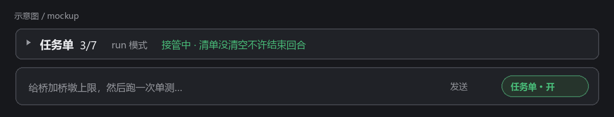
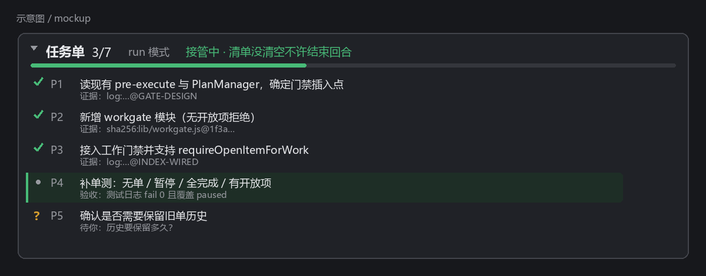
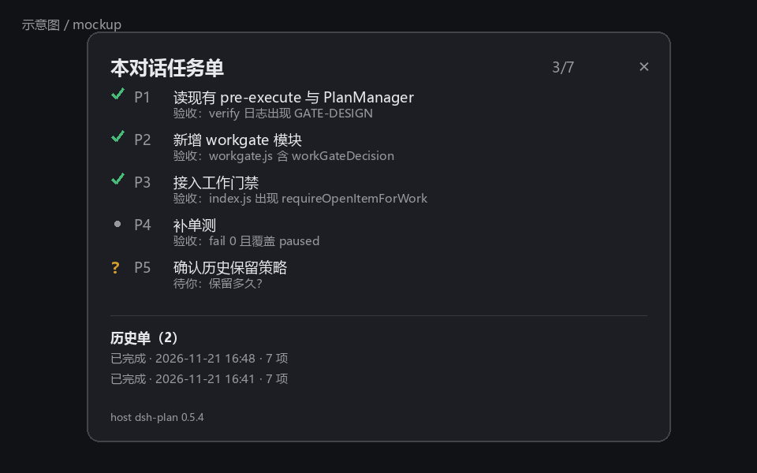

# dsh-plan

**English** · [中文](README.md)

> Seven checkboxes, two approvals, and one rule: a turn cannot end while a required item is still unchecked.

A tiny task-list guard for DSH. It does not interrogate the model and does not assume it is up to something. It does exactly three things:

1. Before work starts, split the task into a plan with **at least 7 required items**, each with an observable "done" criterion;
2. An item can be checked off only when it is done; required items must bring evidence (a file hash or a log line);
3. **While a required item is unchecked, the turn may not end.** The plugin steers the next item back into the session instead of accepting "I'll continue".

---

## 1. What it is actually protecting against

### Not malice. Dumbness.

The model is not evil. It will not study the rules for loopholes or quietly patch its way out of them. It will:

- **forget**, and get dumber as the context fills up;
- **rush**, treating a successful compile as a finished task;
- **narrate work as if it had happened** — "I'll continue the acceptance run" is a promise, not an action.

So there is no audit layer, no claim checker, no anti-bypass threat model here. There is a checklist, and the question is only: **how many zeroes are left**.

### Things that raised the user's blood pressure (paraphrased)

> Four rounds of reading the code, and the A* search still never showed up.
>
> "I can't stand watching this" got interpreted as "stop", and the game was closed too — nobody said stop.
>
> "I'll continue acceptance until P1–P8 have real data." Then nothing happened for a minute.
>
> Build succeeded, therefore "the runnable build is delivered".
>
> Wake up: no bridges, no tunnels verified, three pages of "done".

All of it comes down to the same gap: **progress was not recorded anywhere that can be checked**. The plan is that place.

---

## 2. The rules

### Build the plan first

```
plan_create(items: [
  "Audit upstream for the missing highway feature || comparison table for 2.1.1 vs 2.3.0 committed under docs/",
  "Cap bridge piers || unit test passes and a long-bridge log line exists",
  ...
])
```

- Between **7 and 12 required** items by default (adjustable to any 1–50 range in the plan viewer).
- Every item needs `done_when` — observable, not "make it good".
- `optional` items exist and never block the end.

### Checking an item requires evidence

For `check: "evidence"` required items:

- `sha256:<path>@<hex>` — the file exists and its SHA-256 starts with `<hex>`;
- `log:<path>@<text>` — the file really contains that text.

For `check: "auto"` items the witness is written at plan time and the plugin verifies it.

Evidence is for the **user**, not for the model: checks and their evidence stay in `plan.json`, so an early check is visible immediately.

### While zeroes remain, the turn does not end

At `agent/turn-stopping`:

- required item still `todo` → steer `N items left. Next: P3 …` back into the session;
- everything `done` / `needs_user` → allow the end;
- `optional` never matters.

If the model keeps coming back without making progress (no check, no add, no park, no edit), enforcement stops after `maxForcedWithoutProgress` continuations and writes `stalled.md` instead of burning tokens forever.

### Items that need the user never block

"It looks like the original?" — only the user can judge that. Use `plan_needs_user`:

- it is **not** in the blocking set, **no popup, no request, no hang**;
- all such items are rendered into `.dsh-plan/<session>/questions.md` for when the user is back;
- a rejected acceptance becomes a new required item and reopens the plan.

> This fixes a real deadlock: putting "needs your click" items inside the checklist means the whole project freezes on item 1 while the user is away. The checklist holds only what the model can finish; anything needing your eyes is a separate bill.

### Only two actions ask for approval

| Gate | Behaviour |
|---|---|
| Archiving / terminating a session | one approval prompt |
| Deleting existing files or directories | one approval prompt |

Launching a game, opening a new session, building, installing, writing files, sending cross-session messages: **no prompt**, just normal execution (game launches and new sessions are also recorded in `actions.jsonl`; everything else stays in DSH's own logs). Deleting scratch files under the OS temp directory or `.dsh-plan` is not gated.

### The user's stop always wins

- Stop button / Ctrl+C aborts the turn; `agent/turn-stopping` never even fires after an abort, so the plugin physically cannot block it;
- chat phrases like 停 / 先停一下 / 急停 / 暂停 pause the plan and it does **not** auto-resume;
- 不要停 / 别停 / 我没说停就不停 are read as "continue";
- 我走了 / 我睡了 is not a stop — leaving is not stopping.

### 7. No plan means no tool calls at all

With the switch on, **every tool call** is refused outright (a failed tool call, not a hint) when:

- the session has no plan at all;
- the plan is paused (you said stop);
- the plan has no open item (everything is done or waiting on you).

Two exceptions only: `plan_*` (create / edit / check) and `ask_user_question` (asking is not work). Reads, searches, web fetches and commands all need a plan first.

To work, create a plan first, or `plan_update add` to the existing one.

> This is the other half of enforcement: previously only "a turn may not end with an unchecked item" was enforced, so the model could do work — or even read — without ever creating a plan. `requirePlanForAllTools` (default on) selects this all-tools mode; turning it off falls back to the older narrow mode (write / command / game / subagent only), controlled by `requireOpenItemForWork`.

### 8. A new round archives the old plan; an interruption allows one rewrite

- A plain user message retires the previous plan: it is archived under `.dsh-plan/<session>/plans/`, the current slot is emptied, and the next round must create a new plan.
- **A paused plan is retired too** — otherwise it would occupy the slot forever and every round would show the same checklist.
- Exceptions: run mode while unpaused (you are steering one long job), and a plan that still has items waiting on you (the message may be an answer).
- If the old plan was **interrupted** (required items still open), the model gets exactly one rewrite hint: `plan_create` a new plan or `plan_update add` an item, then continue.
- Archives are kept and listed from the assistant-message "Plan" button with time, reason and item count.

---

## 3. How it is built

### Hooks

| Event / API | Use |
|---|---|
| `tools/pre-execute` | the two gates; everything else `next()` |
| `agent/turn-stopping` | the stop rule; `agent.steer()` with the next item |
| `session/event` (`user/message`) | only `source.kind === 'user'` counts for stop/continue/run |
| `session/event` (`turn/end`) | abort pauses the plan |
| `systemPrompt.section` | a short rules block per step |

The plugin never reads model prose to decide progress. State comes from `plan.json`.

### Files

```
<workspace>/.dsh-plan/<sessionId>/
  plan.json      current plan (atomic write)
  questions.md   items waiting on the user, rendered
  stalled.md     stall report, written once
  log.jsonl      change log
  actions.jsonl  game launches / new peer sessions
```

After restart, resume, fork or compaction, the plan is read back by session id; checkboxes survive.

### Model

```json
{
  "version": 1,
  "sessionId": "session-…",
  "mode": "task | run",
  "paused": false,
  "items": [
    {
      "id": "P1",
      "text": "Cap bridge piers",
      "done_when": "unit test passes and a long-bridge log line exists",
      "type": "required | optional",
      "check": "evidence | auto",
      "status": "todo | done | needs_user",
      "evidence": "sha256:out/pier.txt@1a2b3c4d…",
      "question": "(needs_user only)"
    }
  ]
}
```

### Tools

| Tool | Purpose |
|---|---|
| `plan_create` | build a plan (≥7 required) |
| `plan_status` | read it back (also memory after compaction) |
| `plan_check` | check one item with evidence / auto witness |
| `plan_needs_user` | park one item on the user |
| `plan_update` | add / edit / remove / reset (remove needs a reason) |

### Config

```yaml
- id: dsh-plan
  name: dsh-plan
  config:
    minRequiredItems: 7
    maxRequiredItems: 12
    archiveGate: true
    deleteGate: true
    maxForcedWithoutProgress: 12
    requireOpenItemForWork: true
    requirePlanForAllTools: true
```

### Web dock

> The three images below are **mockups** that illustrate the layout; they are not real conversation screenshots.



*Collapsed: one status line and the switch, nothing more.*



*Expanded: item status, acceptance criteria and recorded evidence; the next item is highlighted.*



*The `Plan` button in the assistant-message action row opens a read-only viewer with archived plans.*

A plan dock sits above the composer, only when this session has a plan. **It starts collapsed** — click `▸` to expand:

- one status line: `Holding the turn until the checklist is clear` / `Checklist clear, the turn may end` / `Paused by you` / `Stalled, enforcement stopped`;
- a `3/7` progress row and bar;
- every item's status, its `done_when`, and the evidence recorded when checked (`sha256:` / `log:`);
- the **next** item is highlighted (the one the model is being pushed toward), and `needs_user` questions are shown inline.

Data comes from the read-only `GET /_dsh-plan/state?sessionId=…` endpoint (polled every 1.5s), computed from `plan.json` and never from model prose. The dock has no action buttons: stop and continue are still yours, through the composer or the stop button.

**A switch sits at the right of the composer: `Plan · on / off`.** Turning it off disables the work gate and the stop rule for that session (no plan required, nothing held); the value persists in `.dsh-plan/<session>/settings.json` and survives a restart. Default on. The switch is not routed through the model — one click applies immediately.

**A `Plan` button sits in the assistant-message action row (next to like / dislike)**: it opens a read-only panel with this conversation's current plan and the recently archived plans (time, reason, item count).

**The same panel lets you change the plan size range**: `Plan size [7] – [12]` with a Save button, 1–50, affecting only plans created afterwards. Default 7–12; saved into `.dsh-plan/<session>/settings.json`.

### Known limits

- Delete detection is **heuristic** (command-string matching), not a sandbox; under full access a sufficiently clever command can still get through.
- When no approval channel exists, the two gates **fail closed**; every other path fails open so a broken guard cannot trap a session.
- Only deletes that go through tool calls are covered; raw Node file deletes inside `run_code` are not.
- Archive gating matches tool names (`cross_session_kill`, `agent_teams_delete`); a new archiving tool needs a config entry.

---

## 4. Install / develop

```powershell
dsh plugin --profile <profile> add <path-to>/dsh-plan-0.4.1.tgz
```

Or point `plugin_manager` → `install_bundle` at the tgz. Restart DSH once to load it.

```powershell
npm test          # node --test, no install needed
```

The only peer dependency is `@deepseek-ai/dsh-tools`, supplied by the DSH runtime.

## 5. Before publishing

Publishing is a separate, deliberate step. [DESENSITIZE.md](DESENSITIZE.md) is the checklist to run before it; it is a process, not a property this README certifies.
