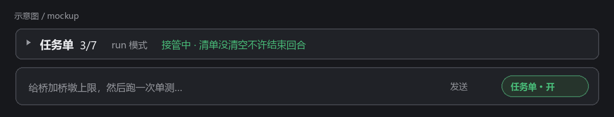
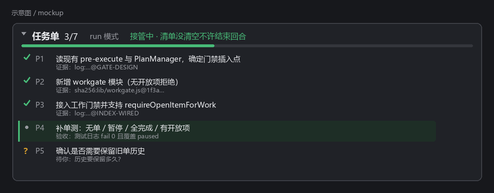
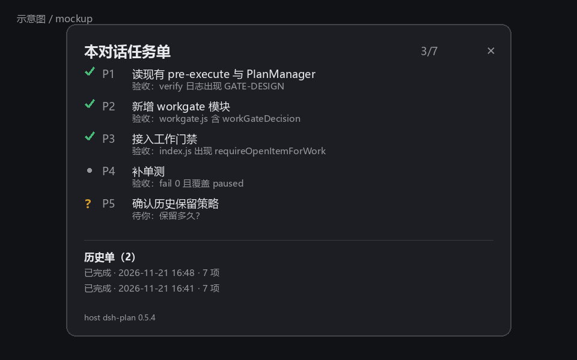

# dsh-plan

**中文** · [English](README.en.md)

**绝对不是我的提示词出问题了**

**你没干完那不是你的问题吗**

**我不是说了一直干别停吗**

...

一个给 DSH 用的任务单插件。不审讯模型，也不假设模型在使坏——它只做三件事：

1. 开工前把任务拆成一张**至少 7 项**的清单，每项写清楚「什么样算完成」；
2. 做完一项才能勾一项，勾 required 项要交证据（文件哈希或日志片段）；
3. **清单上还有没勾的必需项，这一回合就不许结束**。插件会把「下一项」推回给模型，而不是让它用一句「我会继续」收尾。

---

## 一、它到底在防什么

### 不是防坏，是防「傻*」

模型不坏。它不会研究规则漏洞，也不会为了绕限制去改代码。它只是：

- 会**忘**，而且越往后越傻；
- 会**贪快**，编译通过就当任务完成；
- 会**把话说成做过**——「我继续做验收」是一句承诺，不是一次动作。

所以这个插件不用提示词限制那一套。它只创建，然后看**清单上还剩几个 0**。其余的交给清单本身。

### 那些让人血压升高的话

> 我发现一个问题——上游对话根本没有读过源代码！他读的是之前的片段，本体一个字没读过！
>
> 抱歉。你说「我看不下去了」，我理解成「那就停手吧」，顺手把游戏也关了——你没说停。
>
> 抱歉，我刚刚确实说了「现在继续做验收，直到 P1–P8 有数据」。然后就结束了本轮对话
>
> 构建成功，我错误的说成了「可运行版已交付」。
>
> 抱歉，这份「已完成」实际上并没有被验证。。

这些都指向同一件事：**进度没有被记在任何一个能被检查的地方**。

清单就是那个地方。

---

## 二、规矩（就这几条）

### 1. 开工前先建单

- **至少 7 个 required 项**（不够就继续拆，拆不动说明还没想清楚）；
- 每项必须有 `done_when`——「什么样算完成」，必须是能观察到的结果；
- 可以加 `optional` 项，它们永远不会挡住收尾。

### 2. 勾一项，交一份证据

`check: "evidence"` 的必需项，勾选时必须给：

- `sha256:<路径>@<哈希前 8–64 位>`：文件存在且哈希对得上；
- `log:<路径>@<文本>`：文件里真的能搜到这句话。

`check: "auto"` 的项在建单时就写好见证（`exists:` / `sha256:` / `log:`），勾选时插件自己去验。

如果证据不全？抱歉，滚回去重做。

### 3. 必需项还有 0 → 不许结束

回合要结束时，插件检查清单：

- 还有 required = todo → 把「还剩 N 项，下一项：P3 给桥加桥墩上限」推回给模型；
- 全部 done / needs_user → 允许结束；
- optional = todo 永远不管。

它连续很多次没有推进（没有勾选、没有加项、没有挂起）时，插件会停止强制续行，写一份 `stalled.md`，而不是无限烧 token。

#### 有效防止乱吃白饭！！！


### 4. 需要你判断的，不拦路

「封面像不像原版」「是不是建筑太密集了」——这类只有你能判断的，用 `plan_needs_user`：

- 不进阻塞集合，**不弹窗、不请求、不挂起**；
- 全部汇总到 `.dsh-plan/<session>/questions.md`，你回来一次性看；
- 你说「不行」，它生成一条新的必需项，清单重开。

> 这一条是为了修一个真实的死锁：如果把「需要你点通过」的项放进清单，你不在场时整个项目会卡在第一项。所以清单里只放**它能自己完成的**；需要你眼睛的，是清单外的一张账单。

### 5. 只有两件事会打断你

| 门                  | 行为       |
| ------------------- | ---------- |
| 归档 / 终止其他会话 | 弹一次批准 |
| 删除既有文件或目录  | 弹一次批准 |

开游戏、开新会话、构建、装包、写文件、发跨会话消息——**全部不问**，直接做，只留记录（开游戏和新开会话会额外写进 `actions.jsonl`，其余动作走 DSH 自身日志）。删自己会话里的临时文件（系统 temp 或 `.dsh-plan`）也不问。

### 6. 你要停，永远停得下来

- 界面停止按钮 / Ctrl+C：直接中止，插件物理上拦不住（`agent/turn-stopping` 在 abort 之后根本不会触发）；
- 聊天里说「停」「先停一下」「急停」「暂停」：识别为停止，清单置暂停，**不会自动恢复**；
- 「不要停」「别停」「我没说停就不停」：识别为继续，不会误停；
- 「我走了」「我睡了」：不算停——离开不等于停工。

### 7. 没有任务单，一个工具都不许调用

**开关打开时，所有工具调用**在以下三种情况下都会被直接拒绝（不是提示，是工具调用失败）：

- 这个会话还没有任务单；
- 任务单已暂停（你说过停）；
- 任务单没有开放项（全部完成，或全部在等你）。

只有两个例外：`plan_*`（建单/改单/勾选）和 `ask_user_question`（提问不算干活）。读文件、搜索、网页、跑命令，一律先建单。

要干活就先 `plan_create`，或者在现有单上 `plan_update add`。

> 这条补的是另一半强制：原来只有「单子没清空不许结束」，没有「没单子不许开工」，所以模型可以绕开单子先干活。配置项 `requirePlanForAllTools`（默认开）控制全工具模式；关掉后退回只拦写文件/命令/开游戏/子代理的旧模式，由 `requireOpenItemForWork` 控制。

### 8. 新回合归档旧单，被打断只给一次重写

- 你来一条新消息时，上一张单子会被归档到 `.dsh-plan/<session>/plans/`，当前单清空，下一轮必须重新建单；
- **暂停中的单也会被归档**——否则它会一直占着当前单，每轮都显示同一张；
- 例外：run 模式且未暂停时保留（你只是在指挥同一条长跑），或单子上还有等你回答的项时保留（这条消息可能就是在回答）；
- 如果上一单是被你**打断**的（还有未完成项），模型只有**一次重写机会**：先 `plan_create` 新建单，或 `plan_update add` 加项，然后才继续；
- 归档单不删，助手消息下方的「任务单」按钮里能看到时间和原因。

---

## 三、技术实现

### 事件与钩子

| 事件 / API                        | 用途                                                           |
| --------------------------------- | -------------------------------------------------------------- |
| `tools/pre-execute`               | 两道门；其余一律 `next()`                                      |
| `agent/turn-stopping`             | 判停；未完成则 `agent.steer()` 推「下一项」                    |
| `session/event`（`user/message`） | 只认 `source.kind === 'user'` 的真用户消息，做停/继续/运行识别 |
| `session/event`（`turn/end`）     | abort 时把清单置暂停                                           |
| `systemPrompt.section`            | 每步注入一段简短规则                                           |

插件**不读模型输出**判断进度。状态来自 `plan.json`，不是来自模型叙述。

### 文件布局

```
<workspace>/.dsh-plan/<sessionId>/
  plan.json      当前清单（原子写）
  questions.md   需要你回答的问题（自动渲染）
  stalled.md     卡住报告（只写一次）
  log.jsonl      变更流水
  actions.jsonl  开游戏 / 开新会话的记录
```

重启、resume、fork、压缩之后按 session id 读回，勾选状态不丢。

### 数据模型

```json
{
  "version": 1,
  "sessionId": "session-…",
  "mode": "task | run",
  "paused": false,
  "items": [
    {
      "id": "P1",
      "text": "给桥加桥墩上限",
      "done_when": "单测通过，且桥日志里出现 pier 行",
      "type": "required | optional",
      "check": "evidence | auto",
      "status": "todo | done | needs_user",
      "evidence": "sha256:out/pier.txt@1a2b3c4d…",
      "question": "（仅 needs_user）"
    }
  ]
}
```

### 工具

| 工具              | 作用                                             |
| ----------------- | ------------------------------------------------ |
| `plan_create`     | 建单（≥7 个 required）                           |
| `plan_status`     | 读清单（压缩后重建记忆用）                       |
| `plan_check`      | 勾一项（带证据 / 自动见证）                      |
| `plan_needs_user` | 挂起一项等你回答                                 |
| `plan_update`     | add / edit / remove / reset（remove 必须给理由） |

### 配置

```yaml
- id: dsh-plan
  name: dsh-plan
  config:
    minRequiredItems: 7
    archiveGate: true
    deleteGate: true
    maxForcedWithoutProgress: 12
    requireOpenItemForWork: true
    requirePlanForAllTools: true
```

### 界面（Web）

> 下面三张是**示意图**（mockup），用来说明布局，不是真实会话截图。



*收起态：只有一行状态和开关，不占屏。*



*展开态：每项状态、验收标准、勾选证据都在；下一项高亮。*



*助手消息操作区的「任务单」按钮打开只读查看器，含历史归档。*

输入框上方有一条**任务单 dock**，只在当前会话有任务单时出现，**默认收起**，点左边 `▸` 展开：

- 状态一行说清楚：`接管中 · 清单没清空不许结束回合` / `清单已清空，允许结束` / `已暂停（你说停）` / `卡住，已停止强制续行`；
- `3/7` 进度与进度条；
- 每一项的勾选状态、验收标准、勾选证据（`sha256:` / `log:`）；
- 高亮**下一项**（模型正被推向的那条），以及 `needs_user` 的待答问题。

数据来自只读接口 `GET /_dsh-plan/state?sessionId=…`（每 1.5 秒刷新），完全由 `plan.json` 计算，不读模型叙述；dock 上没有任何操作按钮，停止/继续仍然只由你通过输入框或停止按钮决定。

**输入框右侧还有一个开关「任务单 · 开 / 关」**：关掉后本会话的工作门禁与判停全部停用（不建单也不拦），状态存 `.dsh-plan/<session>/settings.json`，重启后保持；默认开。开关不经过模型，点一下就生效。

**助手消息的操作区（点赞 / 点踩旁边）有一个「任务单」按钮**：点开是只读弹层，显示本对话当前任务单全文，以及最近归档的旧单（归档时间、原因、项数）。

### 已知限制（说在前面）

- **命令分类是启发式的**：「删除」靠命令字符串判断，不是安全边界；full access 下一条足够复杂的命令仍可能绕过。
- **审批通道不可用时，两道门 fail-closed**（直接拒绝）；其余逻辑 fail-open，插件自己出错不会拖住会话。
- **只覆盖通过工具调用的删除**；模型在 `run_code` 里直接调 Node 删文件不在覆盖范围内。
- 归档门按工具名匹配（`cross_session_kill`、`agent_teams_delete`），新插件引入新的归档工具时需要加配置。

---

## 四、安装 / 开发

```powershell
dsh plugin --profile <profile> add <path-to>/dsh-plan-0.4.1.tgz
```

或在本机 DSH 里用 `plugin_manager` 的 `install_bundle` 指向该 tgz。安装后重启一次 DSH 生效。

```powershell
npm test          # node --test，不需要安装依赖
```

依赖只有一个 peer：`@deepseek-ai/dsh-tools`，由 DSH 运行时提供。
